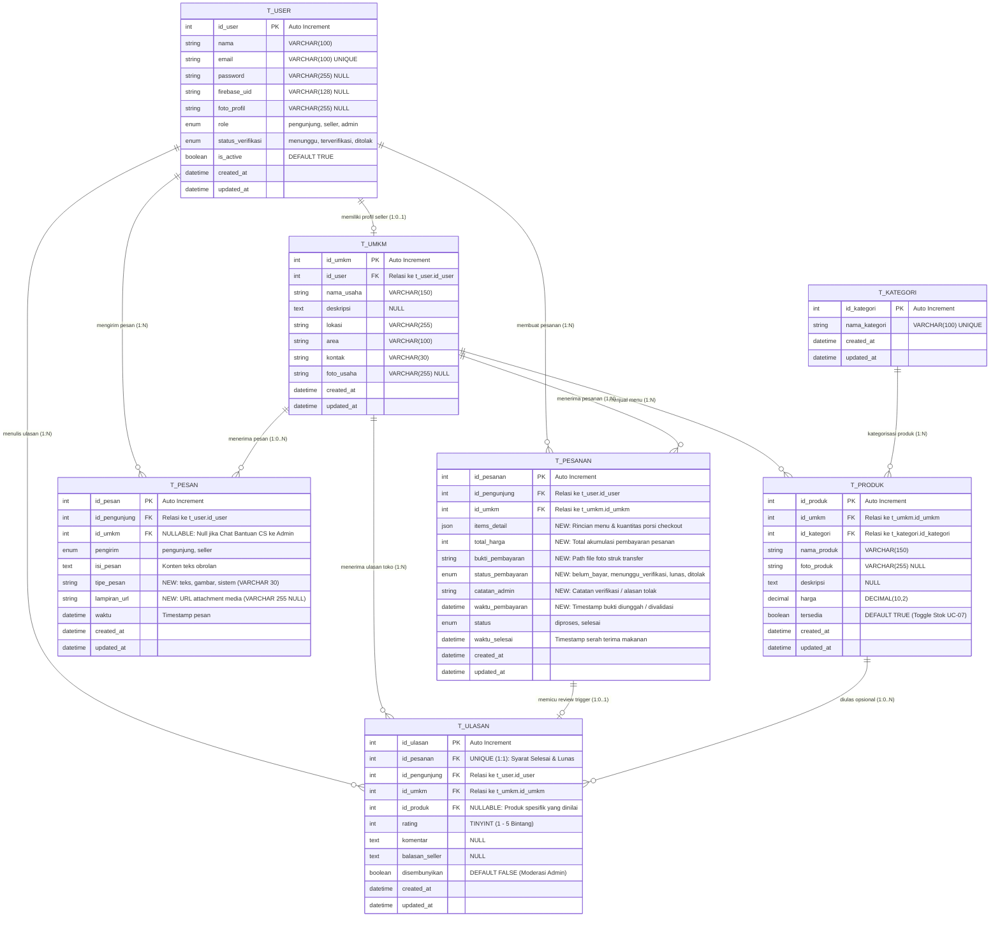

# DOKUMEN AUDIT WORKFLOW, VISION & SCOPE, DAN PANDUAN SIDANG DOSEN
## Proyek: JajanRia (E-Commerce Kuliner Kampus Polibatam • PBL TRPL-104)

---

## 📌 1. Evolusi Vision & Scope: Mengapa JajanRia Kini Disebut E-Commerce?

Dalam perancangan awal PBL, platform ini direncanakan sebagai direktori non-transaksional karena keterbatasan API pembayaran pihak ketiga. Namun, dengan adanya pembaruan sistem terkini (penambahan keranjang porsi menu, checkout pesanan tercatat, upload bukti struk transaksi, verifikasi langsung oleh masing-masing UMKM, dan riwayat pesanan), JajanRia secara resmi telah bertransformasi menjadi **Platform E-Commerce Kuliner Kampus Semi-Otomatis (Direct-to-Seller Order with Decentralized Manual Transfer Verification)**.

### Tabel Perbandingan Arsitektur:
| Fitur / Alur | Versi Awal (Katalog Pasif) | Versi Terkini (E-Commerce Kampus) |
|---|---|---|
| **Pemesanan Menu** | Hanya melihat foto & chat tanya stok | **Aktif:** Pilih kuantitas (+/- porsi) & checkout tercatat |
| **Pembayaran** | Transaksi tidak tercatat di sistem | **Aktif:** Transfer mandiri & upload bukti foto struk |
| **Status Pembayaran** | Tidak ada status bayar | **4 Tahap:** `belum_bayar` &rarr; `menunggu_verifikasi` &rarr; `lunas` / `ditolak` |
| **Verifikasi Pembayaran** | Tidak ada peran verifikator | **Desentralisasi:** Masing-masing Mitra UMKM memverifikasi struk & mutasi secara mandiri |
| **Pengawasan Admin** | Tidak ada | **Supervisi:** Admin memantau audit log transaksi & menangani sengketa/support |
| **Riwayat Transaksi** | Hanya riwayat obrolan teks | **Aktif:** Order History terstruktur dengan rincian harga |
| **Pemberian Ulasan** | Setelah status chat selesai | **Protektif:** Syarat pesanan **Selesai** + Pembayaran **Lunas** diverifikasi Seller |

---

## 🛡️ 2. Batas Aman Proyek (Out-of-Scope Realistis PBL)

Agar cakupan proyek tidak melebar (*scope creep*) dan tetap aman diuji oleh dosen vokasi TRPL:
1. **TIDAK Menggunakan Payment Gateway Otomatis (Midtrans/Xendit/Stripe):**
   - Menghindari potongan biaya transaksi (*fee admin per order*), kebutuhan NPWP perusahaan/izin badan hukum (PT/CV), serta kerumitan webhook eksternal.
2. **TIDAK Menggunakan Kurir Live GPS Tracking:**
   - Seluruh pesanan menggunakan metode **Self Pick-Up** (mahasiswa memesan dari kelas/asrama, lalu mengambil langsung ke kios kantin/gerbang kampus tanpa antre).
3. **TIDAK Menggunakan Pengurangan Stok Otomatis Per Pcs:**
   - Pedagang street food memasak secara fleksibel; stok dikontrol melalui fitur **Toggle Ketersediaan Menu (Tersedia / Habis)** sesuai UC-07.

---

## 🔄 3. Alur Kerja Lengkap 3 Peran (End-to-End Workflow)

```
[CUSTOMER / PENGUNJUNG]
   │
   ├─► 1. Login Google Firebase & Eksplorasi Menu Katalog
   ├─► 2. Tentukan Porsi Menu & Klik Checkout (Status: Diproses, Belum Bayar)
   ├─► 3. Transfer Dana ke QRIS/Rekening Lapak & Upload Foto Struk (Status: Menunggu Verifikasi)
   │
[SELLER / MITRA UMKM - PENGELOLA TRANSAKSI MANDIRI]
   │
   ├─► 4. Notifikasi Pesanan Masuk di Dashboard Seller & Cek Foto Struk Transfer
   ├─► 5. Cek Notifikasi m-Banking/QRIS Sendiri -> Klik "✓ Lunas" (atau "✗ Tolak" jika tidak sesuai)
   ├─► 6. Memasak & Menyiapkan Makanan Hangat di Kios
   ├─► 7. Mahasiswa Mengambil Makanan (Self Pick-up) & Seller Klik "Selesai"
   │
[ADMINISTRATOR - PLATFORM SUPERVISOR]
   │
   ├─► A. Verifikasi Pendaftaran Lapak Seller Baru (KYC Mahasiswa/Warga Kampus)
   ├─► B. Monitoring & Audit Log Seluruh Transaksi Kampus (Dispute Resolution / Bantuan Transaksi)
   ├─► C. Pengelolaan Kategori Menu & Moderasi Ulasan
   │
[REVIEW TRIGGER]
   │
   └─► 8. Tombol "⭐ Beri Penilaian" Aktif di Layar Customer -> Submit Ulasan Bintang 1-5
```

---

## ⚖️ 4. Matriks Status Transaksi (State Machine)

| Status Pesanan | Status Pembayaran | Arti Kondisi Sistem | Aksi yang Terbuka |
|---|---|---|---|
| **Diproses** | `belum_bayar` | Pesanan dicatat, pembeli belum mengirim struk | Customer: Unggah bukti foto struk |
| **Diproses** | `menunggu_verifikasi` | Struk transfer telah diunggah oleh pembeli | **Seller UMKM:** Cek struk & klik Setujui Lunas / Tolak |
| **Diproses** | `lunas` | Bukti pembayaran sah telah diverifikasi Seller | Seller: Memasak & menyiapkan pesanan |
| **Selesai** | `lunas` | Makanan telah diambil mahasiswa di kios | Customer: **Tombol Beri Ulasan Bintang Aktif** |
| **Diproses** | `ditolak` | Foto struk buram / nominal tidak cocok | Customer: Unggah ulang bukti transfer valid |

---

## 🔎 5. Hasil Audit Jujur: Keunggulan Arsitektur Desentralisasi Transaksi UMKM

1. **Mengapa Verifikasi Dilakukan UMKM (Bukan Admin)? (Inovasi Utama):**
   - *Alasan Operasional:* Uang transfer atau scan QRIS masuk langsung ke rekening bank/dompet digital milik masing-masing mitra UMKM, bukan ke kas rekening kampus/admin. Admin tidak memiliki akses ke mutasi rekening pedagang.
   - *Eliminasi Bottleneck (Jam Makan Siang):* Saat rush-hour kuliah (11.30–13.00), ratusan pesanan masuk serentak. Jika pesanan harus menunggu verifikasi manual admin satu per satu, antrean akan macet dan pesanan lambat dimasak. Dengan verifikasi mandiri di dashboard seller, penjual langsung menerima notifikasi dan memverifikasi dalam hitungan detik.
2. **Peran Strategis Admin yang Tetap Kuat (Governance):**
   - Admin bertindak sebagai **Gatekeeper & Auditor**:
     a. Memverifikasi kelayakan lapak penjual baru (KYC: KTP/KTM, foto kios, izin jualan kampus).
     b. Memantau log audit transaksi kampus secara menyeluruh untuk transparansi.
     c. Menangani keluhan / sengketa melalui layanan Customer Support terpusat (`id_umkm = null`).
     d. Memoderasi ulasan yang tidak etis atau berbau spam.
3. **Proteksi Penipuan Transaksi (Anti-Fraud):**
   - Pembeli tidak bisa mengklaim makanan sebelum penjual mengonfirmasi status `lunas`. Tombol review rating bintang juga hanya terbuka jika pesanan telah `selesai` dan `lunas`.

---

## 👥 6. Pemetaan 8 File Blade ke 6 Anggota Kelompok

| No | Anggota | File HTML & CSS Mandiri | File Blade Asli di Laravel | Tugas & Penjelasan Saat Audit |
|---|---|---|---|---|
| 1 | **Anggota 1** | `01_katalog_beranda.html` | `landing.blade.php` | **Katalog Publik:** Hero banner promosi, search bar, filter area kampus, dan grid kartu UMKM. |
| 2 | **Anggota 2** | `02_detail_toko.html` | `store-detail.blade.php` | **Detail Toko:** Cover banner hero (GoFood style), highlight bar (rating, lokasi, harga), dan daftar menu. |
| 3 | **Anggota 3** | `03_login.html` & `04_register.html` | `auth/login.blade.php`<br>`auth/register.blade.php` | **Autentikasi Pengguna:** Google Firebase Login (Pengunjung) & form registrasi penjual (upload foto spanduk & pilih area). |
| 4 | **Anggota 4** | `04_dashboard_seller.html` | `seller/dashboard.blade.php` | **Dashboard Seller:** Panel AdminLTE hijau, tabel produk kuliner (toggle stok), cek bukti struk pembayaran, verifikasi lunas/tolak, dan tombol ubah status pesanan selesai. |
| 5 | **Anggota 5** | `05_panel_admin.html` & `08_admin_konfirmasi.html` | `admin/dashboard.blade.php`<br>`admin/konirmasi.blade.php` | **Panel Administrator:** Verifikasi seller baru, audit log transaksi kampus, moderasi ulasan, dan penanganan tiket sengketa customer support. |
| 6 | **Anggota 6** | `07_customer_dashboard.html`<br>*(atau `06_chat_dan_ulasan.html`)* | `dashboard.blade.php`<br>`components/floating-chat.blade.php` | **Customer Workspace & Chat:** 3 tab customer (katalog, chat interaktif pembeli-penjual, order history dengan upload struk, modal rating bintang). |

---

## 🎓 7. Bank Soal & Tanya Jawab Kritis Sidang Dosen (FAQ)

### Q1: *"Apakah aplikasi JajanRia ini tergolong E-Commerce atau hanya katalog promosi?"*
> **Jawaban:** JajanRia adalah **E-Commerce Kuliner Kampus Semi-Otomatis (Direct-to-Seller Order with Decentralized Manual Transfer Verification)**. Mahasiswa dapat memilih porsi jajanan, checkout pesanan tercatat ke database, mengunggah bukti transfer langsung ke UMKM, memantau riwayat status pembayaran secara real-time, hingga memberi ulasan rating bintang setelah makanan selesai disiapkan oleh penjual.

### Q2: *"Mengapa verifikasi pembayaran dilakukan langsung oleh masing-masing UMKM dan bukan menunggu Admin?"*
> **Jawaban:** Ini adalah keputusan arsitektur sistem yang paling realistis dan tepat untuk marketplace kuliner kampus:
> 1. **Aliran Kas Riil:** Dana transfer mandiri atau QRIS masuk langsung ke rekening pedagang yang bersangkutan, bukan ke kas Admin. Admin tidak memiliki hak atau akses mengecek mutasi mobile banking puluhan lapak kantin.
> 2. **Eliminasi Bottleneck (Jam Makan Siang):** Di jam istirahat kuliah (11.30–13.00), ratusan mahasiswa memesan serentak. Jika harus menunggu persetujuan Admin satu per satu, antrean akan macet total. Dengan verifikasi mandiri di dashboard seller, penjual dapat langsung mengonfirmasi struk dalam beberapa detik dan segera memasak.
> 3. **Peran Admin sebagai Supervisor:** Admin tetap mengawasi seluruh riwayat pembayaran lewat audit log kampus dan bertindak sebagai penengah netral jika terjadi sengketa (dispute) antara pembeli dan penjual.

### Q3: *"Mengapa tidak mengintegrasikan Payment Gateway otomatis seperti Midtrans atau Xendit?"*
> **Jawaban:** Untuk skala UMKM kuliner mikro kampus dan batasan proyek PBL mahasiswa TRPL, sistem transfer manual langsung ke QRIS pedagang adalah solusi paling tepat dan ekonomis. Metode ini **100% bebas biaya komisi transaksi per pesanan**, tidak memerlukan legalitas izin badan hukum perusahaan (PT/CV), serta sangat mudah dipahami oleh pedagang street food tradisional di lingkungan kampus.

### Q4: *"Bagaimana sistem pengiriman makanannya? Apakah ada integrasi kurir atau driver ojek online?"*
> **Jawaban:** Sistem pengiriman menggunakan metode **Self Pick-Up (Ambil Sendiri di Lapak/Kios Kantin)**. Mahasiswa memesan dan membayar terlebih dahulu dari kelas atau asrama, kemudian mengambil pesanan yang sudah matang tanpa perlu membuang waktu mengantre di jam istirahat kuliah.

### Q5: *"Bagaimana sistem mencegah kecurangan bukti transfer palsu dari pembeli?"*
> **Jawaban:** Melalui verifikasi langsung oleh pedagang penerima dana. Ketika pembeli mengunggah struk transfer, status pembayaran masuk ke tahap `menunggu_verifikasi`. Mitra UMKM memeriksa keaslian foto struk dan membandingkannya dengan notifikasi mutasi rekening/QRIS mereka. Hanya pesanan yang telah dikonfirmasi `lunas` yang akan dimasak dan diserahkan kepada pembeli.

### Q6: *"Mengapa tabel dashboard menggunakan header (thead) hijau #2E8B3D?"*
> **Jawaban:** Warna hijau `#2E8B3D` adalah identitas brand JajanRia yang merepresentasikan kesegaran pangan dan pertumbuhan UMKM. Struktur tabel mengikuti standar antarmuka **AdminLTE 3** dengan teks tebal putih dan border `1px solid #246F31` yang telah teruji keterbacaannya.

### Q7: *"Mengapa pengunjung menggunakan login Google Firebase sedangkan Penjual/Admin menggunakan Email/Password?"*
> **Jawaban:** Ini adalah strategi pemisahan peran (*Role-Based Access Control*). Pengunjung (mahasiswa) membutuhkan proses login instan satu klik via akun Google kampus tanpa mengisi formulir manual yang panjang. Sebaliknya, Seller dan Admin memerlukan otentikasi kredensial email/password sesi tersentralisasi untuk menjaga keamanan data toko dan panel administratif.

---

## 🗄️ 8. Entity Relationship Diagram (ERD) & Struktur Database Terkini

Database JajanRia dirancang menggunakan Relational Database Management System (MySQL/MariaDB) yang terdiri dari **7 Entitas Utama** yang saling terintegrasi secara normal (3NF).

### 8.1. Diagram Visual ERD (Mermaid Relational Model)



---

### 8.2. Tabel Rincian Penambahan & Perubahan Skema Baru (Changelog Migration)

Berikut adalah daftar perubahan dan kolom baru yang ditambahkan pada migrasi database fase transaksional:

| No | Nama Tabel | Kolom / Modifikasi Baru | Tipe Data | Keterangan & Tujuan Fungsional |
|---|---|---|---|---|
| 1 | `t_pesanan` | `items_detail` | `JSON NULL` | **Fitur Checkout Menu:** Menyimpan snapshot daftar menu yang dibeli, kuantitas porsi (+/-), dan harga satuan saat checkout dilakukan. |
| 2 | `t_pesanan` | `total_harga` | `UNSIGNED INT (Def: 0)` | **Kalkulasi Biaya:** Total akumulasi nominal yang wajib ditransfer mahasiswa ke lapak UMKM. |
| 3 | `t_pesanan` | `bukti_pembayaran` | `VARCHAR(255) NULL` | **Upload Struk Transfer:** Menyimpan nama/path file foto struk bukti transfer mandiri atau QRIS yang diunggah pembeli. |
| 4 | `t_pesanan` | `status_pembayaran` | `ENUM ('belum_bayar', 'menunggu_verifikasi', 'lunas', 'ditolak')` | **State Machine Pembayaran:** Mengontrol tahap validasi pembayaran oleh UMKM/Admin secara real-time. |
| 5 | `t_pesanan` | `catatan_admin` | `VARCHAR(255) NULL` | **Catatan Feedback:** Menyimpan catatan alasan jika transfer ditolak (misal: "Struk buram" atau "Nominal kurang"). |
| 6 | `t_pesanan` | `waktu_pembayaran` | `DATETIME NULL` | **Audit Timestamp:** Waktu saat pembeli mengunggah struk atau saat pembayaran disahkan lunas. |
| 7 | `t_pesan` | `id_umkm` *(Modifikasi)* | `UNSIGNED INT NULL` | **Pemisahan Customer Support:** Diubah menjadi `nullable`. Jika `NULL`, pesan dialihkan langsung ke Administrator (bukan lapak UMKM). |
| 8 | `t_pesan` | `tipe_pesan` | `VARCHAR(30) (Def: 'teks')` | **Multimedia Chat:** Membedakan pesan teks biasa, pengiriman gambar struk, atau notifikasi otomatis dari sistem. |
| 9 | `t_pesan` | `lampiran_url` | `VARCHAR(255) NULL` | **Attachment File:** Menyimpan tautan lampiran foto di dalam percakapan chat. |

---

### 8.3. Hubungan Kardinalitas & Integritas Referensial (Foreign Keys)

1. **`t_user` &rarr; `t_umkm` (1 : 0..1):**
   - Satu pengguna dengan role `seller` memiliki tepat satu profil toko UMKM. Jika role `pengunjung` atau `admin`, tidak memiliki data di `t_umkm`.
   - `ON UPDATE CASCADE, ON DELETE CASCADE`.
2. **`t_umkm` &rarr; `t_produk` (1 : N):**
   - Satu lapak UMKM dapat memiliki banyak produk menu makanan/minuman.
   - `ON UPDATE CASCADE, ON DELETE CASCADE`.
3. **`t_kategori` &rarr; `t_produk` (1 : N):**
   - Satu kategori (misal: "Makanan Berat", "Minuman", "Camilan") mengelompokkan banyak menu dari berbagai UMKM.
   - `ON UPDATE CASCADE, ON DELETE CASCADE`.
4. **`t_user` (Pengunjung) & `t_umkm` &rarr; `t_pesanan` (1 : N):**
   - Seorang pengunjung dapat membuat banyak pesanan ke lapak yang berbeda. Setiap pesanan terikat pada satu lapak UMKM tujuan.
   - `ON UPDATE CASCADE, ON DELETE CASCADE`.
5. **`t_pesanan` &rarr; `t_ulasan` (1 : 0..1) — *REVIEW TRIGGER*:**
   - Kolom `id_pesanan` pada `t_ulasan` bersifat **UNIQUE**. Hal ini menjamin secara arsitektur basis data bahwa **satu transaksi pesanan hanya boleh diulas 1 kali saja**, mencegah manipulasi rating ulasan (*anti-spam*).
   - Tombol modal ulasan baru dapat di-submit apabila pesanan berstatus `selesai` dan pembayaran `lunas`.
6. **`t_user` & `t_umkm` &rarr; `t_pesan` (1 : N):**
   - Pesan obrolan menghubungkan mahasiswa dengan lapak penjual. Jika `id_umkm` bernilai `NULL`, obrolan otomatis dialihkan ke thread Customer Support Admin.


